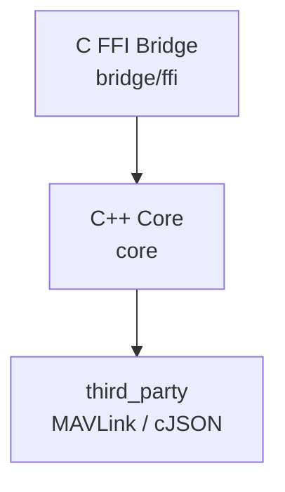
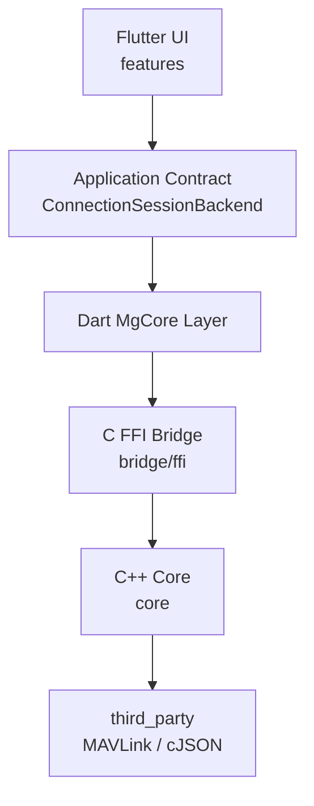
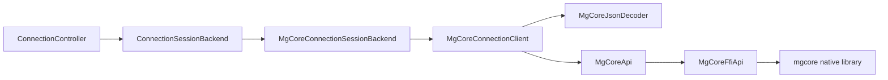

# 架构说明

## 当前架构状态

`mgroundcontrol` 的长期架构目标是 **C++ 后端核心 + C FFI 桥接 + Flutter 前端语义契约 + 跨平台一致 UI 设计系统**。目标平台按优先级为 Windows、Android、macOS、iOS。当前这份源码包包含并验证了 C++ 后端、C FFI bridge 和 Flutter macOS 桌面前端骨架；Windows 前端目录已生成，仍需在 Windows 机器上构建验证；Android 和 iOS 需要重新打开平台工程并补齐移动端权限、native library 打包和文件系统适配。

核心原则：

- 飞控协议、连接生命周期、安全敏感命令、任务传输、参数传输和遥测缓存属于后端。
- C FFI 只暴露稳定、C 兼容、可测试的公共契约。
- 前端不得直接复制后端状态机，不得直接拼接 MAVLink 或底层 FFI 快照。
- 后续前端应通过应用层语义契约接入后端能力。
- Flutter 业务 UI 必须保持一套跨平台页面，Windows 和 macOS 以同屏一致为验收目标，Android 和 iOS 共享同一套设计系统。
- 前端视觉必须最大程度复刻 macOS / iOS 的通用风格气质，但只能通过项目自有 token、wrapper、自绘效果和商业授权清晰的素材实现。
- 不得复制 Apple 官方资产、SF Symbols、系统截图、专有图标、官方文案、平台专有界面或任何可能暗示官方关联的素材。

## 顶层依赖方向

当前已存在链路：



目标前端链路：



依赖必须单向流动。UI 层不得直接依赖 FFI、MAVLink、transport、参数传输或任务传输实现。

## C++ 后端结构

`core/` 是后端领域核心：

- `core/src/transport/`：串口、TCP、UDP、内存链路、连接管理和端口发现。
- `core/src/mavlink/`：MAVLink adapter、发送器、命令队列、参数缓存、任务传输。
- `core/src/vehicle/`：飞控模型、多机管理、连接状态和当前飞控选择。
- `core/src/mission/`：航点、围栏、集结点、测绘任务和任务管理。
- `core/src/calibration/`：陀螺仪、加速度计、罗盘、气压计校准。
- `core/src/firmware/`：ArduPilot / PX4 固件插件、模式映射和参数重映射。
- `core/src/telemetry/`：遥测环形缓冲、ADSB 等遥测能力。
- `core/src/settings/` 与 `core/src/log/`：飞行日志、MAVLink 日志和日志回放。
- `core/src/sitl/`、`core/src/terrain/`、`core/src/geofence/`、`core/src/video/`：仿真、地形、围栏和视频相关能力。

高风险路径：

- `core/src/mavlink/command_queue.cc`
- `core/src/mavlink/mission_transfer.cc`
- `core/src/mavlink/param_cache.cc`
- `core/src/transport/connection_manager.cc`
- `core/src/transport/serial_link.cc`
- `core/src/transport/tcp_link.cc`
- `core/src/transport/udp_link.cc`
- `core/src/vehicle/vehicle.cc`
- `core/src/vehicle/multi_vehicle_manager.cc`
- `core/src/calibration/calibration_service.cc`

修改这些路径时必须运行聚焦回归测试和默认门禁。

## 传输层

传输层统一实现 `ILink`：

- `SerialLink`：Windows 使用 Win32 串口 API；macOS/Linux 使用 POSIX `termios`。
- `TcpLink`：客户端 TCP 链路。
- `UdpLink`：绑定本地 UDP 端口，并从首个收到的数据包学习远端地址。
- `InMemoryLink`：测试和模拟链路。

连接生命周期由 `ConnectionManager` 管理，负责：

- 创建传输层。
- 连接传输层回调和 MAVLink adapter。
- 心跳记录和心跳丢失检测。
- 自动重连。
- 暴露连接状态。

连接识别成功后，`Vehicle` 会主动请求前端和诊断常用遥测，包括 heartbeat、GPS、姿态、全局位置、VFR HUD、servo output、RC channels 和电池等消息。实时 servo/RC 数据必须以是否收到对应 MAVLink 消息为准，不能把默认缓存值当成真实输出。

## FFI 桥接层

`bridge/ffi/` 是后端对 Flutter、测试工具和外部消费者暴露的 C ABI。

`ffi_api.h` 是 umbrella header：

```text
ffi_api.h
|- ffi_api_core.h
|- ffi_api_connection.h
|- ffi_api_telemetry.h
|- ffi_api_firmware.h
|- ffi_api_params.h
|- ffi_api_mission.h
|- ffi_api_flight.h
|- ffi_api_configuration.h
|- ffi_api_geofence.h
|- ffi_api_logging.h
|- ffi_api_payload.h
\- ffi_api_environment.h
```

实现侧按领域拆分：

- `ffi_vehicle_manager.cc`：多机打开、关闭、选择和设备发现。
- `ffi_vehicle_session.*`：活动飞控上下文解析。
- `ffi_mission_bridge.*`、`ffi_mission_commands.cc`、`ffi_mission_management.cc`：任务相关能力。
- `ffi_flight_mode_state.cc`、`ffi_flight_commands.cc`：飞行模式与飞行命令。
- `ffi_payload_commands.cc`、`ffi_sitl_commands.cc`、`ffi_survey_commands.cc`、`ffi_terrain_commands.cc`：领域命令。
- `ffi_sensor_decode.cc`、`sensor_*_json_serializers.h`：传感器解码和健康视图。
- `mission_json_serializers.h`、`param_json_serializers.h`：领域 JSON 序列化。
- `telemetry_freshness.h`、`telemetry_cache.h`：遥测新鲜度和缓存。
- `ffi_diagnostics.cc`：工业化诊断聚合层。

FFI 约束：

- 只暴露 C 兼容类型。
- `mg_create()` / `mg_destroy()` 管理 MgCore 生命周期。
- 普通返回 `char*` 由调用方通过 `mg_free_string()` 释放。
- `mg_event_callback_t` 的 `json` 参数也由回调方通过 `mg_free_string()` 释放。
- 复杂结果使用 JSON envelope，保持 success/error 语义稳定。

## 固件 Profile 与能力契约

MGC 当前采用 ArduPilot-first，PX4-compatible 路线：ArduPilot 能力优先做深，PX4 先保持通用 MAVLink 能力稳定兼容，并逐步补齐深度适配。

固件差异必须在后端 profile/capability 层显式表达，前端不得通过字符串、字段缺失或数值范围猜测飞控行为。前端或外部工具可通过 `mg_firmware_get_type()` 获取：

- `profile`：`ardupilot`、`px4` 或 `unknown`。
- `vehicle_type`：归一化机型族，例如 `Copter`、`FixedWing`、`Rover`、`Submarine`、`VTOL`。
- `capabilities`：当前飞控/机型明确支持的工作流能力。

新增 ArduPilot 或 PX4 差异行为时，优先补 `core/src/firmware/` 下的固件插件和 FFI 契约测试；不要把固件判断扩散到 UI。

## 高语义诊断契约

底层 `mg_vehicle_get_*`、`mg_params_*`、`mg_mission_*` 接口继续保留，供细粒度能力和调试工具使用。新前端和现场诊断优先使用以下聚合接口：

- `mg_connection_get_diagnostics()`：连接状态、活动飞控、心跳、目标 sysid/component、板卡名称、3 秒 MAVLink 接收链路质量和可重连判断。`link.quality_pct` 只表示活动飞控 MAVLink 包序号统计的成功率；`link.measuring=true` 表示样本不足。
- `mg_operations_get_snapshot()`：参数同步和任务传输等长任务的统一状态视图。
- `mg_operations_cancel()`：长任务取消入口；当前对无活动任务返回明确 no-op 结果。
- `mg_telemetry_get_dashboard_snapshot()`：面向仪表盘的连接、遥测、数据新鲜度和有效性聚合快照。
- `mg_system_get_diagnostics()`：系统级诊断总入口，聚合连接、操作、仪表盘和 last-error。

这些接口的目标是让前端不自行拼接多个底层快照，也不在 UI 层猜测 `valid=false`、心跳年龄、参数进度或 mission 状态。

参数同步使用既有 `mg_params_request_all()` 发出标准 `PARAM_REQUEST_LIST`，并通过 `mg_params_get_progress()` 读取进度。它是只读下载流程，不得与参数写入混用。遥控器信号来自 `mg_rc_get_channels()` 的 `RC_CHANNELS.rssi`，应独立于 `link` 链路质量显示；`0` 和 `255` 表示飞控没有提供有效遥控器信号。

## Flutter 应用层

当前 `app/` 已恢复 Flutter 前端工程骨架。长期目标是一套 Flutter 业务 UI 同时服务 Windows、Android、macOS 和 iOS，其中 Windows 与 Android 是主力验收平台，Windows 与 macOS 的视觉输出必须尽可能一致。主要目录为：

- `app/lib/application/`：应用侧契约、Dart MgCore client、FFI 绑定、JSON 解码和会话后端。
- `app/lib/features/frontstage/`：前台任务工作台页面、view model 和 controller adapter。
- `app/lib/features/shell/`：Flutter app 根入口。
- `app/lib/ui/skin/`：皮肤协议、token、scope 和默认皮肤工厂。
- `app/lib/ui/layouts/`：业务页面依赖的稳定布局入口。
- `app/lib/ui/skins/mac_glass/`：默认浅色玻璃皮肤实现。
- `app/lib/platform/`：平台差异抽象预留。
- `app/test/`：前端测试。

前端架构边界：

- UI feature 只消费应用层契约，不直接调用 MgCore FFI。
- 平台差异集中在 platform adapter 和 native packaging，不进入业务页面。
- 前台默认采用真实地图背景 + 悬浮 UI。地图渲染通过 `features/map/` 封装，后续替换地图供应商或离线瓦片时不改变前台 shell。
- UI 皮肤按编译时固定策略选择。第一套默认皮肤是 `MacGlassSkin`，用于商业安全的 macOS/iOS-inspired 浅色玻璃体验。
- 皮肤可以改变前台/后台布局和组件表现，但不能改变连接、遥测、参数、任务上传下载或危险操作确认语义。
- 正式业务 UI 通过项目自有 wrapper 和皮肤契约构建，避免 `macos_ui`、`liquid_glass_widgets` 等第三方组件直接散落到页面中。
- macOS / iOS 风格复刻是视觉目标，但复刻对象是圆角、磨砂、半透明层级、阴影、工具栏节奏和排版质量等通用设计语言。
- 圆角、磨砂玻璃、半透明层级和柔和阴影属于项目设计系统能力，必须优先在 Windows 和 Android 上做性能与可读性验证。
- 商业发布前必须确认 UI 资产、图标、字体、图片、地图素材和第三方库授权。

目标接入面是 `ConnectionSessionBackend`：

```dart
abstract interface class ConnectionSessionBackend {
  Future<List<ConnectionSerialPort>> listSerialPorts();
  Future<ConnectionOperationResult> connect(ConnectionRequest request);
  Future<ConnectionOperationResult> disconnect();
  Future<ConnectionSessionSnapshot> loadSessionSnapshot(ConnectionRequest request);
  Future<FlightDashboardData> loadTelemetrySnapshot();
  void dispose();
}
```

实现链路：



## 当前生产边界

后端可构建可测试，但以下能力不能视为生产完成：

- 固件刷写：当前为占位实现。
- 视频接收/解码：已有元数据管理，完整链路未验收。
- Android filesystem：当前为占位实现，需要 JNI/AssetManager 上下文。
- Flutter 前端：当前为桌面骨架，真实业务页面和 native library 打包仍需补齐。
- 真实硬件验证：只读连接、参数读取和遥测 dump 已验证；写参数、解锁、切模式、任务执行、校准和电机测试仍不得视为生产验收。

## 架构决策记录

长期架构决策写入 `docs/adr/`：

- ADR 0001：初始架构。
- ADR 0002：复用官方 MAVLink。
- ADR 0003：本地 FFI 桥接。
- ADR 0004：前端接入契约以连接会话为中心。
