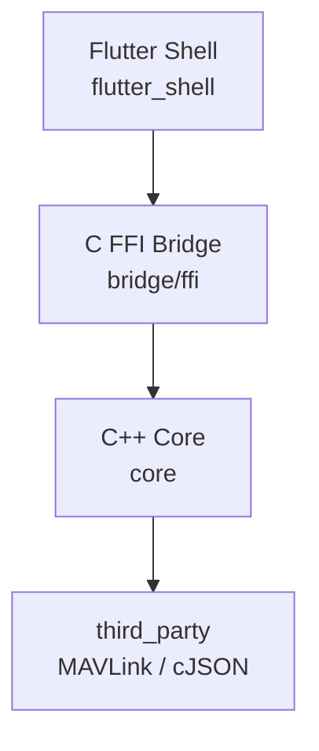

# 架构说明

## 当前架构状态

当前 `main` 分支包含 **C++ 后端核心 + C FFI 契约 + Flutter 外壳**。
`flutter_shell/` 只作为 FFI 的消费者存在，后端仍不得依赖任何 UI 框架。

核心原则：

- 飞控协议、连接生命周期、安全敏感命令、任务传输、参数传输和遥测缓存属于后端。
- C FFI 只暴露稳定、C 兼容、可测试的公共契约。
- 任何前端都必须通过 FFI 语义契约接入后端能力，不得复制后端状态机。
- 后端不得依赖任何 UI 框架、前端语言或页面结构。
- 任何领域功能都不得因前端更换而重写。

## 顶层依赖方向



依赖必须单向流动。`core/` 不得知道 `bridge/ffi/` 的调用者是谁。

## C++ 后端结构

- `core/src/transport/`：串口、TCP、UDP、内存链路、连接管理和端口发现。
- `core/src/mavlink/`：MAVLink adapter、发送器、命令队列、参数缓存、任务传输。
- `core/src/vehicle/`：飞控模型、多机管理、连接状态和当前飞控选择。
- `core/src/mission/`：MAVLink 航点、围栏、集结点、测绘任务和任务管理；任务文档、几何、约束与编译属于后端领域。
- `core/src/calibration/`：陀螺仪、加速度计、罗盘、气压计、遥控器校准。
- `core/src/firmware/`：ArduPilot / PX4 固件插件、模式映射和参数重映射。
- `core/src/telemetry/`：遥测环形缓冲、ADSB 等遥测能力。
- `core/src/settings/` 与 `core/src/log/`：飞行日志、MAVLink 日志和日志回放。
- `core/src/ftp/`：MAVLink FTP 文件传输。
- `core/src/sitl/`、`core/src/terrain/`、`core/src/geofence/`、`core/src/video/`、`core/src/camera/`：仿真、地形、围栏、视频和相机能力。

高风险路径：

- `core/src/mavlink/command_queue.cc`
- `core/src/mavlink/mission_transfer.cc`
- `core/src/mavlink/param_cache.cc`
- `core/src/transport/connection_manager.cc`
- `core/src/transport/serial_link.cc`
- `core/src/transport/tcp_link.cc`
- `core/src/transport/udp_link.cc`
- `core/src/vehicle/vehicle.cc`
- `core/src/vehicle/multi_vehicle_manager.cc`
- `core/src/calibration/calibration_service.cc`

修改这些路径时必须运行聚焦回归测试和默认门禁。持有内部锁时不得执行阻塞 I/O，也不得在持锁期间调用外部回调。

## 传输层

传输层统一实现 `ILink`：

- `SerialLink`：Windows 使用 Win32 串口 API；macOS/Linux 使用 POSIX `termios`。
- `TcpLink`：客户端 TCP 链路。
- `UdpLink`：绑定本地 UDP 端口，并从首个收到的数据包学习远端地址。
- `InMemoryLink`：测试和模拟链路。

连接生命周期由 `ConnectionManager` 管理，负责：

- 创建传输层。
- 连接传输层回调和 MAVLink adapter。
- 心跳记录和心跳丢失检测。
- 在链路失效后清理会话并暴露明确的断连状态；重连由调用方显式发起。
- 暴露连接状态。

连接识别成功后，`Vehicle` 会主动请求常用遥测，包括 heartbeat、GPS、姿态、全局位置、VFR HUD、servo output、RC channels 和电池等消息。实时 servo/RC 数据必须以是否收到对应 MAVLink 消息为准，不能把默认缓存值当成真实输出。

## FFI 桥接层

`bridge/ffi/` 是后端对外部消费者暴露的 C ABI。

`ffi_api.h` 是 umbrella header：

```text
ffi_api.h
|- ffi_api_core.h
|- ffi_api_connection.h
|- ffi_api_telemetry.h
|- ffi_api_firmware.h
|- ffi_api_params.h
|- ffi_api_mission.h
|- ffi_api_flight.h
|- ffi_api_configuration.h
|- ffi_api_geofence.h
|- ffi_api_logging.h
|- ffi_api_payload.h
\- ffi_api_environment.h
```

实现侧按领域拆分：

- `ffi_vehicle_manager.cc`：多机打开、关闭、选择和设备发现。
- `ffi_vehicle_session.*`：活动飞控上下文解析。
- `ffi_mission_bridge.*`、`ffi_mission_commands.cc`、`ffi_mission_management.cc`：任务相关能力。
- `ffi_flight_mode_state.cc`、`ffi_flight_commands.cc`：飞行模式与飞行命令。
- `ffi_payload_commands.cc`、`ffi_sitl_commands.cc`、`ffi_survey_commands.cc`、`ffi_terrain_commands.cc`：领域命令。
- `ffi_sensor_decode.cc`、`sensor_*_json_serializers.h`：传感器解码和健康视图。
- `mission_json_serializers.h`、`param_json_serializers.h`：领域 JSON 序列化。
- `telemetry_freshness.h`、`telemetry_cache.h`：遥测新鲜度和缓存。
- `ffi_diagnostics.cc`：工业化诊断聚合层。

FFI 约束：

- 只暴露 C 兼容类型。
- `mg_create()` / `mg_destroy()` 管理 MgCore 生命周期。
- 普通返回 `char*` 由调用方通过 `mg_free_string()` 释放。
- `mg_event_callback_t` 的 `json` 参数也由回调方通过 `mg_free_string()` 释放。
- 复杂结果使用 JSON envelope，保持 success/error 语义稳定。
- `mg_vehicle_open()` 只创建独立飞控会话，不改变 active/UI focus；`mg_vehicle_select()` 是显式焦点操作。旧的单机便捷连接入口保持连接后选中会话的兼容行为。新增接口应逐步改为显式 vehicle 目标。

## Mission CAD 领域边界

Mission CAD 是面向精确航线设计的后端领域子系统。其可编辑源模型是 `MissionCadDocument`，在局部 ENU 米制坐标中保存点、航段、扫描区和约束；WGS84 仅在地图、导入导出和 MAVLink 编译边界使用。

- `core/mission/cad` 负责文档、编辑历史、约束、编译、校验、估算、诊断和持久化；
  几何参数化实体和导入导出适配器按阶段继续扩展。
- `bridge/ffi` 负责稳定、版本化、前端无关的 C ABI/JSON 契约。
- 任何前端和 CLI 只负责编辑交互与渲染，不能拥有第二套权威几何或航线编译逻辑。
- `MissionPlan` 是编译后的 MAVLink 目标模型；任务上传下载继续由既有 mission transfer 负责。
- 编辑、校验和编译不写飞控；上传是单独、显式的安全敏感操作。

当前已实现的文档模型包含稳定实体 ID、revision、undo/redo、结构化诊断、
命令目录、`.mgcad.json` 序列化，以及编译、上传和回读比对链路。编辑动作不写飞控；
上传必须由调用方显式触发。

任务领域边界由 ADR 0005 约束；新增实现必须先落在 `core/mission/` 和对应的 FFI 契约中。

## 固件 Profile 与能力契约

MGC 当前采用 ArduPilot-first，PX4-compatible 路线：ArduPilot 能力优先做深，PX4 先保持通用 MAVLink 能力稳定兼容，并逐步补齐深度适配。

固件差异必须在后端 profile/capability 层显式表达，调用方不得通过字符串、字段缺失或数值范围猜测飞控行为。可通过 `mg_firmware_get_type()` 获取：

- `profile`：`ardupilot`、`px4` 或 `unknown`。
- `vehicle_type`：归一化机型族，例如 `Copter`、`FixedWing`、`Rover`、`Submarine`、`VTOL`。
- `capabilities`：当前飞控/机型明确支持的工作流能力。

新增 ArduPilot 或 PX4 差异行为时，优先补 `core/src/firmware/` 下的固件插件和 FFI 契约测试。

## 高语义诊断契约

底层 `mg_vehicle_get_*`、`mg_params_*`、`mg_mission_*` 接口继续保留，供细粒度能力和调试工具使用。前端和现场诊断优先使用以下聚合接口：

- `mg_connection_get_diagnostics()`：连接状态、活动飞控、心跳、目标 sysid/component、板卡名称、3 秒 MAVLink 接收链路质量和可重连判断。`link.quality_pct` 只表示活动飞控 MAVLink 包序号统计的成功率；`link.measuring=true` 表示样本不足。
- `mg_operations_get_snapshot()`：参数同步和任务传输等长任务的统一状态视图。
- `mg_operations_cancel()`：长任务取消入口；当前对无活动任务返回明确 no-op 结果。
- `mg_telemetry_get_dashboard_snapshot()`：面向仪表盘的连接、遥测、数据新鲜度和有效性聚合快照。
- `mg_system_get_diagnostics()`：系统级诊断总入口，聚合连接、操作、仪表盘和 last-error。

这些接口的目标是让调用方不自行拼接多个底层快照，也不猜测 `valid=false`、心跳年龄、参数进度或 mission 状态。

完整的公开 API 分组、兼容入口和新增/弃用规则见
[`bridge/ffi/API_CATALOG.md`](../bridge/ffi/API_CATALOG.md)。

参数同步使用既有 `mg_params_request_all()` 发出标准 `PARAM_REQUEST_LIST`，并通过 `mg_params_get_progress()` 读取进度。它是只读下载流程，不得与参数写入混用。遥控器信号来自 `mg_rc_get_channels()` 的 `RC_CHANNELS.rssi`，应独立于 `link` 链路质量显示；`0` 和 `255` 表示飞控没有提供有效遥控器信号。

批量参数导入与确认写入使用参数变更集：`mg_params_prepare_change_set()` 以飞控完整参数缓存生成去重后的差异预览，`mg_params_commit_change_set()` 统一执行元数据校验、`_ENABLE` 最后写入和逐项结果汇总。调用方只保留尚未确认的草稿，不能自行拥有导入比对、写入排序或失败恢复语义；单参数实时写入仍使用 `mg_params_set()`。

## 当前生产边界

后端具备测试结构，但当前 checkout 缺少 MAVLink C 生成头，恢复可复现构建后仍有以下生产缺口：

- 固件刷写：当前为占位实现。
- 视频接收/解码：已有元数据管理，完整链路未验收。
- Android filesystem：当前为占位实现，需要 JNI/AssetManager 上下文。
- 新增会话入口 `mg_vehicle_open()` 不再改变 active/UI focus；旧命令族仍通过显式 `mg_vehicle_select()` 选择目标，下一阶段将继续补充显式 `vehicle_id` 命令目标。
- 真实硬件验证：只读连接、参数读取和遥测 dump 已验证；写参数、解锁、切模式、任务执行、校准和电机测试仍不得视为生产验收。

## 架构决策记录

长期架构决策写入 `docs/adr/`：

- ADR 0001：初始架构。
- ADR 0002：复用官方 MAVLink。
- ADR 0003：本地 FFI 桥接。
- ADR 0005：Mission CAD 由后端领域模型负责。
- ADR 0006：波形显示管线——采集保真、显示可读。
- ADR 0007：界面字体跨平台统一，以 macOS 端为设计基准。
