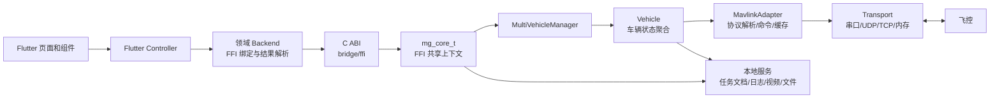
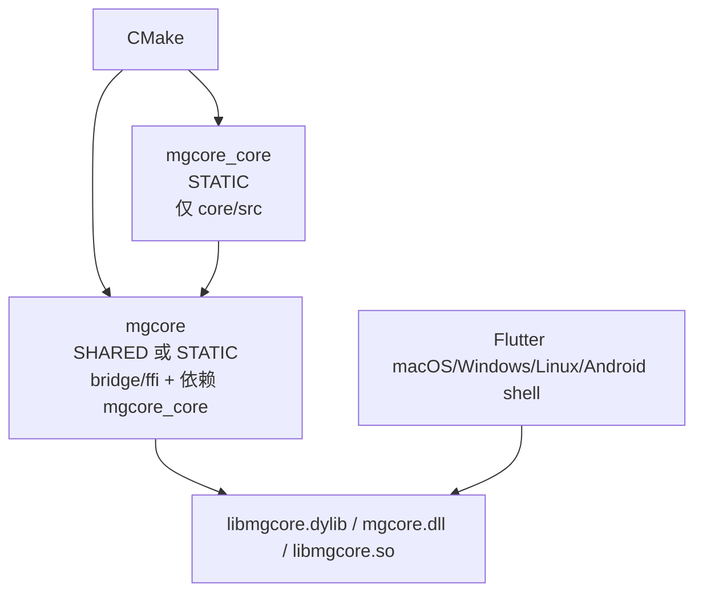
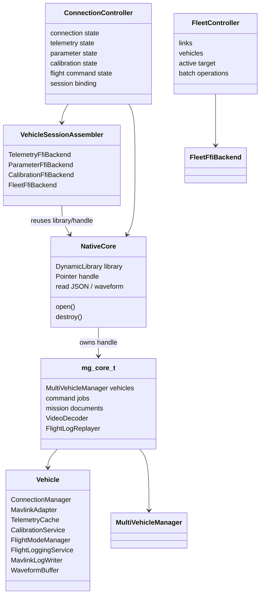
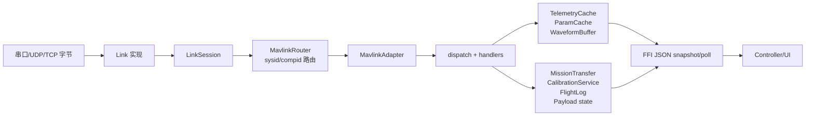
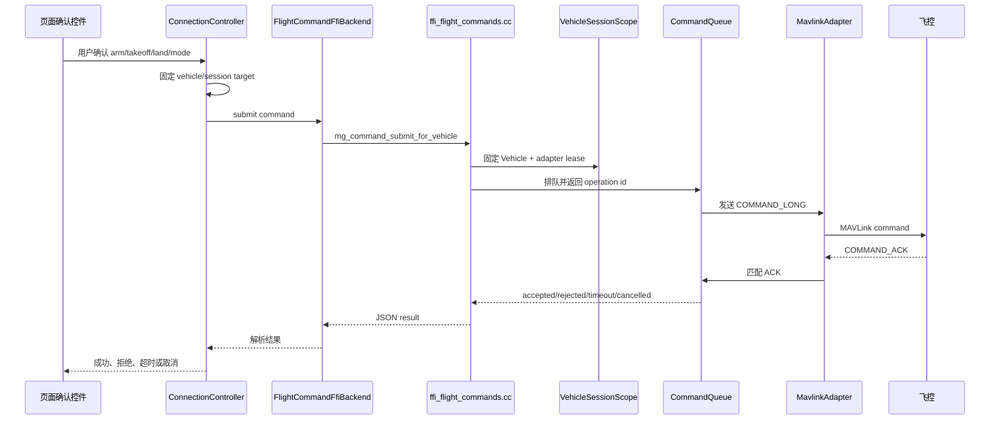
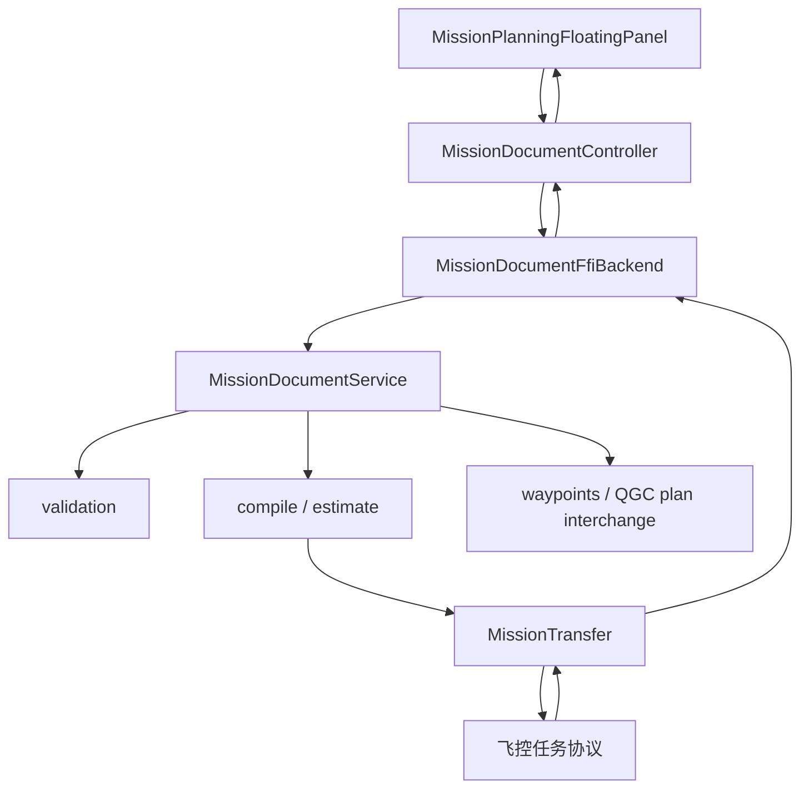
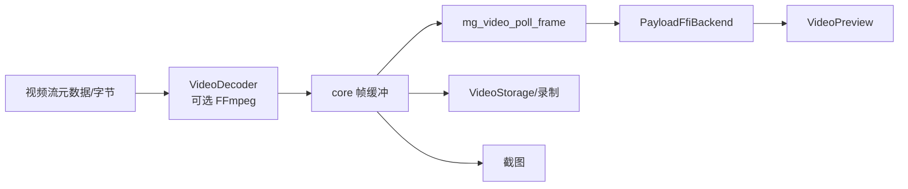

# M-GCS 当前架构地图

更新时间：2026-10-14。

本文是基于当前工作区代码、`CMakeLists.txt`、Flutter 入口、FFI 声明和现有测试整理的架构说明。它用于帮助定位代码和理解调用链，不是新的开发约束，也不要求每次改动同步更新。

## 1. 一眼看懂

M-GCS 是一个 Flutter 地面站外壳，加一个 C++ 核心库，中间用 C ABI/JSON FFI 连接。



实际依赖方向保持为：

```text
flutter_shell -> bridge/ffi -> core -> third_party
```

其中 `third_party` 主要是生成的 MAVLink 头文件和 cJSON。项目不修改第三方源码。

## 2. 构建目标和运行时对象



`CMakeLists.txt` 的实际目标拆分如下：

- `mgcore_core`：编译 `core/src`，只暴露 `core/include`、MAVLink 和 cJSON；
- `mgcore`：编译 `bridge/ffi`，链接 `mgcore_core`，向外暴露 `bridge/ffi` 头文件；
- `MGCORE_HAS_FFMPEG`：可选启用本地视频解码；默认关闭；
- 测试目标：由 `MGCORE_BUILD_TESTS=ON` 开启，CTest 按 offline、simulation、hardware、manual 分类。

## 3. 运行时核心对象



### 3.1 Flutter 侧的实际职责

- `NativeCore`：打开动态库、创建/销毁 `mg_core_t`、绑定少量公共入口、统一释放 C ABI 返回的字符串；
- 领域 backend：按领域绑定 FFI 符号，把 JSON/原生缓冲转换成 Dart 可用数据；
- `VehicleSessionAssembler`：当前只装配四个基础 backend：Telemetry、Parameter、Calibration、Fleet；支持 lazy-init 和测试注入；
- `ConnectionController`：仍然是最大协调器，持有连接、会话、飞行命令和多个业务控制器的生命周期；
- `FleetController`：负责多链路、多车辆、活动目标、批量动作和目标校验；
- 领域 Controller：管理页面需要的状态机、刷新节奏、错误文本和会话切换清理；
- 页面/组件：只消费 Controller 的状态和动作，不直接解释 MAVLink 原始值。

### 3.2 C++ 侧的实际职责

- `mg_core_t`：一个 FFI 核心句柄对应的共享运行时，保存车辆管理器、异步命令任务、任务文档、本地视频解码器和 tlog 回放器；
- `MultiVehicleManager`：维护多个车辆和连接会话；
- `Vehicle`：聚合一架飞机的连接、MAVLink、遥测、校准、飞行模式、日志和波形状态；
- `MavlinkAdapter`：协议入口，负责消息分发、发送、命令 ACK、参数、任务、日志和设备状态处理；
- `VehicleSessionScope`：FFI 调用开始时固定车辆、连接、MAVLink lease、目标 sysid/compid，避免 UI 焦点改变导致异步操作串车；
- `VehicleTargetScope`：批量或显式车辆操作的线程局部目标覆盖，不修改全局活动车辆。

## 4. 连接和多机流程

```mermaid
sequenceDiagram
    participant Page as ConnectionFloatingPanel
    participant Fleet as FleetController
    participant Backend as FleetFfiBackend
    participant ABI as mg_connection_open
    participant Manager as MultiVehicleManager
    participant Vehicle as Vehicle
    participant Link as ConnectionManager/Link
    participant FC as 飞控

    Page->>Fleet: openLink(connectionSpec)
    Fleet->>Backend: open(uri)
    Backend->>ABI: mg_connection_open(core, uri)
    ABI->>Manager: 创建连接/会话
    Manager->>Vehicle: 创建或绑定 Vehicle
    Vehicle->>Link: 打开串口/UDP/TCP
    Link->>FC: 等待 HEARTBEAT
    FC-->>Link: HEARTBEAT
    Link->>Vehicle: 解析并更新身份
    Vehicle->>Manager: 登记 sysid/compid/固件/机型
    Backend-->>Fleet: 返回 link/vehicle id
    Fleet-->>Page: 刷新快照和连接状态
```

连接对象有三种常见粒度：

- link：物理或网络链路；
- route：共享链路上的车辆路由；
- vehicle/session：被 UI 和异步操作绑定的目标车辆。

不能用“当前活动车辆”替代已经开始的异步操作目标。批量动作会通过 `FleetController` 逐个校验目标，再由 FFI 的 target scope 路由到对应车辆。

## 5. 入站 MAVLink 数据流



处理特点：

1. Transport 只负责链路和帧收发；
2. Router 按车辆身份分发；
3. Adapter 解析 MAVLink 并更新拥有者状态；
4. FFI 查询缓存或操作状态，通常返回 JSON；
5. Dart Controller 定时刷新，并把结果转成页面模型。

## 6. 飞行命令和 ACK 流程



“已提交/已发送”与“飞控已接受”是两层状态。ACK 不到、ACK 拒绝或超时不能被包装成成功。

## 7. 任务文档流程



任务文档是编辑模型；飞控任务列表是传输模型。二者不应因为上传或读取而隐式混为一个对象。文档还绑定 session id，切换飞控后需要重新核对或创建文档。

## 8. 本地视频和日志流程



`.tlog` 回放是本地会话，不属于某架飞控；因此回放器挂在 `mg_core_t` 而不是 `Vehicle`。机载日志和 MAVLink FTP 则需要当前车辆的连接和 adapter。

## 9. 逐文件说明：根目录和构建

| 文件 | 功能 |
|---|---|
| `AGENTS.md` | 当前唯一现行协作规则、依赖方向、异步会话和质量完成线。 |
| `CLAUDE.md` | 其他编码代理的入口说明；不替代 `AGENTS.md`。 |
| `README.md` | 项目简介、当前产品范围和快速入口。 |
| `CHANGELOG.md` | 版本历史和已完成变更记录。 |
| `LICENSE` | 项目许可证。 |
| `CMakeLists.txt` | C++ 标准、平台识别、FFmpeg 选项、core/FFI 目标拆分、源文件和测试注册。 |
| `flutter_shell/pubspec.yaml` | Flutter 包名、Dart SDK、运行时依赖、测试依赖、字体和资源声明。 |
| `flutter_shell/pubspec.lock` | Flutter/Dart 依赖解析锁定结果。 |
| `.clang-format` | C/C++ 格式化配置。 |
| `.editorconfig` | 编辑器通用缩进和换行约定。 |
| `.gitattributes` | Git 属性和跨平台文本处理设置。 |
| `.gitignore` | 构建产物、缓存、生成文件和本地环境忽略规则。 |
| `.dockerignore` | Docker 构建上下文的忽略规则。 |
| `.githooks/pre-commit` | 本地提交前检查入口。 |
| `.github/workflows/build.yml` | CI 构建和测试工作流。 |
| `Dockerfile` | 后端开发/检查容器镜像定义。 |
| `docker-compose.yml` | Docker 开发服务编排。 |
| `docker/entrypoint.sh` | Docker 容器启动脚本。 |

## 10. 逐文件说明：FFI Bridge

### 10.1 FFI 公共头文件

| 文件 | 功能 |
|---|---|
| `bridge/ffi/ffi_api.h` | 总入口；公共类型、错误码、版本、生命周期和跨模块声明。 |
| `bridge/ffi/ffi_api_core.h` | `mg_create`、`mg_destroy`、字符串释放、操作快照和核心级查询。 |
| `bridge/ffi/ffi_api_connection.h` | 串口/UDP/TCP 打开、关闭、链路和会话状态。 |
| `bridge/ffi/ffi_api_configuration.h` | 校准、串口 UART 映射和配置相关导出。 |
| `bridge/ffi/ffi_api_firmware.h` | 固件类型、能力和版本读取。 |
| `bridge/ffi/ffi_api_flight.h` | 飞行命令提交、轮询、取消和飞行模式。 |
| `bridge/ffi/ffi_api_logging.h` | 机载日志、tlog、MAVLink FTP 和文件操作。 |
| `bridge/ffi/ffi_api_mission.h` | 任务文档、任务传输、围栏、Rally、校验和交换格式。 |
| `bridge/ffi/ffi_api_params.h` | 参数读取、写入、进度和参数角色/描述符。 |
| `bridge/ffi/ffi_api_payload.h` | 相机、云台、视频流、帧轮询、录制和截图。 |
| `bridge/ffi/ffi_api_telemetry.h` | 遥测快照、姿态、GPS、电池、导航、波形和消息。 |

### 10.2 FFI 实现和内部辅助

| 文件 | 功能 |
|---|---|
| `bridge/ffi/ffi_core_context.h` | 定义 `mg_core_t`；持有车辆管理器、命令任务、任务文档、视频解码器和 tlog 回放器。 |
| `bridge/ffi/ffi_internal.h` | FFI 共用错误、活动车辆、参数、遥测、任务和 adapter 路由辅助。 |
| `bridge/ffi/ffi_vehicle_session.h` | `VehicleSessionView`、`VehicleSessionScope` 和 `VehicleTargetScope` 声明。 |
| `bridge/ffi/ffi_vehicle_session.cc` | 解析并固定目标车辆、连接、MAVLink lease 和目标 sysid/compid。 |
| `bridge/ffi/ffi_response.h` | FFI response 结构和 JSON 响应辅助声明。 |
| `bridge/ffi/ffi_helpers.h` | C ABI 到 C++ 类型、字符串和通用转换辅助。 |
| `bridge/ffi/ffi_error.cc` | 错误码、线程局部 last error 和错误字符串。 |
| `bridge/ffi/ffi_operations_internal.h` | 异步 operation 内部状态和任务辅助声明。 |
| `bridge/ffi/ffi_mission_internal.h` | 任务 FFI 内部共用类型和处理辅助。 |
| `bridge/ffi/mission_json_serializers.h` | 任务文档/实体/校验结果 JSON 序列化。 |
| `bridge/ffi/ffi_operations.cc` | operation 快照、轮询、取消和异步结果管理。 |
| `bridge/ffi/ffi_utility.cc` | 通用工具、版本和杂项 ABI 实现。 |
| `bridge/ffi/ffi_diagnostics.cc` | 核心诊断和诊断 JSON 聚合。 |
| `bridge/ffi/ffi_connection.cc` | 连接打开、关闭、串口/网络配置和连接状态导出。 |
| `bridge/ffi/ffi_serial.cc` | 串口枚举、UART 名称和串口相关导出。 |
| `bridge/ffi/ffi_vehicle.cc` | 单车选择、状态、身份和车辆级查询。 |
| `bridge/ffi/ffi_vehicle_manager.cc` | 多车列表、链路列表、活动车和会话级查询。 |
| `bridge/ffi/ffi_firmware.cc` | 固件识别、能力、版本和插件结果导出。 |
| `bridge/ffi/ffi_config.cc` | 参数描述符、参数角色和配置读取/写入。 |
| `bridge/ffi/ffi_config_extra.cc` | 配置扩展入口，如 UART/执行器等辅助配置。 |
| `bridge/ffi/ffi_params.cc` | 参数批量读取、按名读取、写入状态和进度。 |
| `bridge/ffi/ffi_commands.cc` | 命令提交、operation 创建和公共命令入口。 |
| `bridge/ffi/ffi_flight_commands.cc` | COMMAND_LONG、ACK 等待、拒绝/超时/取消结果。 |
| `bridge/ffi/ffi_flight_modes.cc` | 飞行模式列表、模式标签和机型模式查询。 |
| `bridge/ffi/ffi_calibration.cc` | 校准启动、状态、取消和加速度计步骤确认。 |
| `bridge/ffi/ffi_rc.cc` | RC/遥控器校准相关 ABI。 |
| `bridge/ffi/ffi_telemetry.cc` | 遥测总入口、快照和消息读取。 |
| `bridge/ffi/ffi_telemetry_summary.cc` | 摘要遥测、状态栏和电池/连接摘要。 |
| `bridge/ffi/ffi_telemetry_navigation.cc` | 位置、姿态、导航和距离相关遥测。 |
| `bridge/ffi/ffi_telemetry_sensors.cc` | 传感器、执行器、RC 和设备状态遥测。 |
| `bridge/ffi/ffi_log_commands.cc` | 机载日志、tlog 和 FTP 文件操作导出。 |
| `bridge/ffi/ffi_payload_commands.cc` | 相机、云台、视频、录制和截图导出。 |
| `bridge/ffi/ffi_mission_bridge.h` | 任务文档与任务传输之间的桥接声明。 |
| `bridge/ffi/ffi_mission_bridge.cc` | mission home、计划呈现和上传前准备。 |
| `bridge/ffi/ffi_mission_shared.cc` | 任务 FFI 共用状态、校验和转换。 |
| `bridge/ffi/ffi_mission_commands.cc` | 任务上传、下载、清除、围栏和 Rally 命令。 |
| `bridge/ffi/ffi_mission_document.cc` | 任务文档 CRUD、校验、估算和编译导出。 |
| `bridge/ffi/ffi_mission_interchange.cc` | QGC `.plan`、WPL/waypoints 和 JSON 交换格式。 |
| `bridge/ffi/ffi_mission_catalog.cc` | 任务命令目录和参数描述导出。 |

## 11. 逐文件说明：Core 头文件

### 11.1 公共类型和基础设施

| 文件 | 功能 |
|---|---|
| `core/include/core/core_types.h` | Core 通用类型、结果和基础值对象。 |
| `core/include/core/core_status.h` | 核心状态、状态码和生命周期状态。 |
| `core/include/core/event/event_codes.h` | Core 内部事件编码。 |
| `core/include/core/util/json.h` | JSON 基础类型和解析辅助。 |
| `core/include/core/platform/platform_mutex.h` | 跨平台互斥、条件变量和锁封装。 |
| `core/include/core/platform/platform_socket.h` | 跨平台 socket 类型和网络辅助。 |
| `core/include/core/platform/platform_filesystem.h` | 跨平台文件系统接口。 |

### 11.2 Transport

| 文件 | 功能 |
|---|---|
| `core/include/core/transport/link_interface.h` | 所有链路实现遵守的收发/打开/关闭接口。 |
| `core/include/core/transport/link_config.h` | 串口、UDP、TCP 和内存链路配置。 |
| `core/include/core/transport/link_factory.h` | 根据 URI/配置创建链路。 |
| `core/include/core/transport/link_session.h` | 链路会话、帧接收和生命周期协调。 |
| `core/include/core/transport/connection_manager.h` | 心跳、连接状态、重连和 adapter 绑定。 |
| `core/include/core/transport/in_memory_link.h` | 测试和回环使用的内存链路。 |
| `core/include/core/transport/serial_link.h` | POSIX/Windows 串口链路。 |
| `core/include/core/transport/android_usb_serial_link.h` | Android USB 串口链路声明。 |
| `core/include/core/transport/serial_port_discovery.h` | 本机串口扫描和设备描述。 |
| `core/include/core/transport/tcp_link.h` | TCP 客户端链路。 |
| `core/include/core/transport/udp_link.h` | UDP 链路、远端学习和共享端点。 |

### 11.3 MAVLink、车辆和固件

| 文件 | 功能 |
|---|---|
| `core/include/core/mavlink/mavlink_adapter.h` | MAVLink 适配器主接口。 |
| `core/include/core/mavlink/mavlink_router.h` | 按系统/组件 ID 把消息路由到车辆。 |
| `core/include/core/mavlink/mavlink_message_names.h` | MAVLink 消息 ID 到可读名称的映射。 |
| `core/include/core/vehicle/vehicle.h` | 单架 Vehicle 的子系统聚合和访问入口。 |
| `core/include/core/vehicle/multi_vehicle_manager.h` | 多车辆、活动车辆和车辆会话管理。 |
| `core/include/core/vehicle/vehicle_link_manager.h` | Vehicle 与链路/route 的绑定关系。 |
| `core/include/core/firmware/firmware_adapter.h` | 固件识别、能力和固件适配入口。 |
| `core/include/core/firmware/firmware_plugin.h` | 固件插件抽象和固件专属语义入口。 |
| `core/include/core/firmware/ardupilot_plugin.h` | ArduPilot 插件实现接口。 |
| `core/include/core/firmware/modes/ardu_mode_table.h` | ArduPilot 模式表通用定义。 |
| `core/include/core/firmware/modes/ardu_copter_modes.h` | Copter 模式。 |
| `core/include/core/firmware/modes/ardu_plane_modes.h` | Plane/QuadPlane 模式。 |
| `core/include/core/firmware/modes/ardu_rover_modes.h` | Rover 模式。 |
| `core/include/core/firmware/modes/ardu_sub_modes.h` | Sub 模式。 |
| `core/include/core/firmware/modes/ardu_tracker_modes.h` | Tracker 模式。 |
| `core/include/core/flight/flight_mode_manager.h` | 运行时飞行模式表、当前模式和模式角色。 |

### 11.4 遥测、参数、校准和设备

| 文件 | 功能 |
|---|---|
| `core/include/core/telemetry/telemetry_cache.h` | 最近一次遥测值和每类数据新鲜度。 |
| `core/include/core/telemetry/telemetry_freshness.h` | 遥测过期和时间年龄语义。 |
| `core/include/core/telemetry/telemetry_ring_buffer.h` | 遥测时间序列环形缓存。 |
| `core/include/core/telemetry/waveform_buffer.h` | 波形采样缓存和窗口读取。 |
| `core/include/core/telemetry/flight_message_log.h` | STATUSTEXT/飞控消息日志。 |
| `core/include/core/telemetry/json_builder.h` | Core/FFI 共用 JSON 构建器。 |
| `core/include/core/telemetry/json_serializers.h` | 通用遥测 JSON 序列化。 |
| `core/include/core/telemetry/param_json_serializers.h` | 参数 JSON 序列化。 |
| `core/include/core/telemetry/sensor_health_json_serializers.h` | 传感器健康状态 JSON 序列化。 |
| `core/include/core/config/param_descriptors.h` | 参数描述符、角色、范围和本地化元数据。 |
| `core/include/core/calibration/calibration_service.h` | 校准生命周期、状态和取消协调。 |
| `core/include/core/calibration/calibration_strategy.h` | 不同校准类型的策略接口。 |
| `core/include/core/calibration/calibration_types.h` | 校准类型、阶段和结果类型。 |
| `core/include/core/calibration/calibration_validator.h` | 校准结果和输入校验。 |
| `core/include/core/calibration/strategies/gyro_calibration.h` | 陀螺仪校准策略。 |
| `core/include/core/calibration/strategies/accel_calibration.h` | 加速度计校准策略。 |
| `core/include/core/calibration/strategies/compass_calibration.h` | 罗盘校准策略。 |
| `core/include/core/calibration/strategies/baro_calibration.h` | 气压计校准策略。 |
| `core/include/core/calibration/strategies/radio_calibration.h` | 遥控器校准策略。 |
| `core/include/core/sensor/sensor_id_decoder.h` | 设备 ID 解码和传感器型号解析。 |

### 11.5 任务、日志、FTP、视频

| 文件 | 功能 |
|---|---|
| `core/include/core/mission/mission_types.h` | 任务项、坐标、Home 和任务传输类型。 |
| `core/include/core/mission/geo_math.h` | 地理距离和坐标计算。 |
| `core/include/core/mission/cad/mission_document.h` | 任务文档服务和编辑模型。 |
| `core/include/core/mission/cad/mission_interchange.h` | 任务交换格式接口。 |
| `core/include/core/mission/cad/mission_command_catalog.h` | 可编辑任务命令目录。 |
| `core/include/core/ftp/mavlink_ftp.h` | MAVLink FTP 异步文件客户端。 |
| `core/include/core/log/logging.h` | 日志写入基础接口和日志类型。 |
| `core/include/core/log/tlog_format.h` | `.tlog` 格式和消息记录类型。 |
| `core/include/core/log/flight_log_replayer.h` | 本地 tlog 打开、步进、seek 和关闭。 |
| `core/include/core/settings/flight_logging_service.h` | 机载日志列表、下载、擦除和进度。 |
| `core/include/core/settings/mavlink_log_writer.h` | MAVLink 链路日志写入。 |
| `core/include/core/video/video_decoder.h` | 可选 FFmpeg 视频解码、帧缓冲和状态。 |

## 12. 逐文件说明：Core 源文件

| 文件 | 功能 |
|---|---|
| `core/src/mavlink/mavlink_adapter.cc` | Adapter 生命周期、链路绑定和基础状态。 |
| `core/src/mavlink/mavlink_adapter_internal.h` | Adapter 内部字段和跨实现声明。 |
| `core/src/mavlink/mavlink_adapter_state.h` | Adapter 状态快照和共享状态结构。 |
| `core/src/mavlink/mavlink_adapter_command.cc` | 命令构造、发送和 ACK 匹配。 |
| `core/src/mavlink/mavlink_adapter_dispatch.cc` | 按 MAVLink 消息 ID 分发消息。 |
| `core/src/mavlink/mavlink_adapter_handlers.cc` | 通用消息处理器和状态更新。 |
| `core/src/mavlink/mavlink_adapter_log.cc` | 日志消息、DataFlash 和记录处理。 |
| `core/src/mavlink/mavlink_adapter_mission.cc` | 任务协议消息和 MissionTransfer 协作。 |
| `core/src/mavlink/mavlink_adapter_params.cc` | 参数协议、PARAM_VALUE/PARAM_ACK 和 ParamCache 协作。 |
| `core/src/mavlink/mavlink_senders.cc` | 各类 MAVLink 消息发送器。 |
| `core/src/mavlink/mavlink_router.cc` | 共享链路上的 sysid/compid 路由。 |
| `core/src/mavlink/command_queue.cc` | 命令排队、去重、等待和结果状态。 |
| `core/src/mavlink/command_queue.h` | CommandQueue 内部接口。 |
| `core/src/mavlink/param_cache.cc` | 参数缓存和请求进度。 |
| `core/src/mavlink/param_cache.h` | ParamCache 内部接口。 |
| `core/src/mavlink/mission_transfer.cc` | 任务、围栏和 Rally 传输状态机。 |
| `core/src/mavlink/mission_transfer.h` | MissionTransfer 内部接口。 |
| `core/src/mavlink/mavlink_message_names.cc` | 消息名称映射实现。 |
| `core/src/transport/connection_manager.cc` | 连接状态、心跳和重连实现。 |
| `core/src/transport/link_session.cc` | LinkSession 收发和会话实现。 |
| `core/src/transport/link_config.cc` | URI/配置解析。 |
| `core/src/transport/link_factory.cc` | 链路工厂实现。 |
| `core/src/transport/in_memory_link.cc` | 内存链路实现。 |
| `core/src/transport/serial_link.cc` | POSIX/Windows 串口实现。 |
| `core/src/transport/android_usb_serial_link.cc` | Android USB 串口实现。 |
| `core/src/transport/serial_port_discovery.cc` | 串口发现实现。 |
| `core/src/transport/tcp_link.cc` | TCP 实现。 |
| `core/src/transport/udp_link.cc` | UDP 实现和远端端点管理。 |
| `core/src/firmware/firmware_adapter.cc` | 固件识别和适配器实现。 |
| `core/src/firmware/firmware_plugin_ardupilot.cc` | ArduPilot 参数、能力、机型和模式语义。 |
| `core/src/flight/flight_mode_manager.cc` | 运行时模式管理。 |
| `core/src/calibration/calibration_service.cc` | 校准服务状态机和异步取消确认。 |
| `core/src/calibration/calibration_validator.cc` | 校准输入/结果验证。 |
| `core/src/calibration/strategies/gyro_calibration.cc` | 陀螺仪策略实现。 |
| `core/src/calibration/strategies/accel_calibration.cc` | 加速度计策略实现。 |
| `core/src/calibration/strategies/compass_calibration.cc` | 罗盘策略实现。 |
| `core/src/calibration/strategies/baro_calibration.cc` | 气压计策略实现。 |
| `core/src/calibration/strategies/radio_calibration.cc` | 遥控器策略实现。 |
| `core/src/calibration/strategies/statustext_match.h` | 校准 STATUSTEXT 成功/失败短语匹配。 |
| `core/src/config/param_descriptors.cc` | 参数描述符 JSON 加载、角色和元数据查询。 |
| `core/src/config/ParameterDescriptors.json` | 参数类型、范围、单位、枚举和角色数据。 |
| `core/src/config/ParameterTranslations.zh-CN.json` | 中文参数分组、名称和描述。 |
| `core/src/mission/geo_math.cc` | Haversine 等地理计算实现。 |
| `core/src/mission/cad/mission_document.cc` | 文档生命周期、CRUD、revision 和持久状态。 |
| `core/src/mission/cad/mission_document_internal.h` | 文档内部结构和实现辅助。 |
| `core/src/mission/cad/mission_validation.cc` | 任务实体和文档校验。 |
| `core/src/mission/cad/mission_compile.cc` | 文档编译成可传输任务计划。 |
| `core/src/mission/cad/mission_estimate.cc` | 距离、时间和任务估算。 |
| `core/src/mission/cad/mission_command_catalog.cc` | 命令目录和参数元数据。 |
| `core/src/mission/cad/mission_interchange.cc` | 通用交换格式实现。 |
| `core/src/mission/cad/mission_waypoints.cc` | QGC WPL/waypoints 格式。 |
| `core/src/mission/cad/mission_qgc_plan.cc` | QGC `.plan` 格式。 |
| `core/src/ftp/mavlink_ftp.cc` | MAVLink FTP 状态机和文件传输。 |
| `core/src/log/flight_log_replayer.cc` | tlog 文件解析和回放。 |
| `core/src/settings/flight_logging_service.cc` | 机载日志服务。 |
| `core/src/settings/mavlink_log_writer.cc` | 链路日志写入。 |
| `core/src/telemetry/telemetry_ring_buffer.cc` | 遥测环形缓冲实现。 |
| `core/src/telemetry/waveform_buffer.cc` | 波形缓冲实现。 |
| `core/src/vehicle/vehicle.cc` | 单车子系统聚合、消息入口和车辆状态。 |
| `core/src/vehicle/multi_vehicle_manager.cc` | 多机发现、管理、活动车和链路路由。 |
| `core/src/vehicle/vehicle_link_manager.cc` | 车辆与 link/route 的绑定实现。 |
| `core/src/video/video_decoder.cc` | 可选 FFmpeg 解码和帧转换。 |
| `core/src/sensor/sensor_id_decoder.cc` | 传感器设备 ID 解码。 |
| `core/src/sensor/SensorDeviceInfo.json` | 传感器设备型号数据。 |
| `core/src/platform/platform_filesystem_posix.cc` | macOS/Linux 文件系统实现。 |
| `core/src/platform/platform_filesystem_win32.cc` | Windows 文件系统实现。 |
| `core/src/platform/platform_filesystem_android.cc` | Android 文件系统实现。 |
| `core/src/transport/USBBoardInfo.json` | USB 飞控板识别数据。 |
| `core/src/transport/USBBoardInfo.LICENSE.txt` | USBBoardInfo 数据的许可说明。 |

## 13. 逐文件说明：Flutter 连接和多机

| 文件 | 功能 |
|---|---|
| `flutter_shell/lib/connection/native_core.dart` | 打开共享库、创建核心句柄、绑定公共符号、释放 JSON 字符串和波形缓冲。 |
| `flutter_shell/lib/connection/connection_controller.dart` | 当前最大的前端协调器：连接、遥测、参数、校准、飞行命令、session 绑定和周期刷新。 |
| `flutter_shell/lib/connection/vehicle_session_assembler.dart` | lazy-init/注入 Telemetry、Parameter、Calibration、Fleet backend。 |
| `flutter_shell/lib/connection/telemetry_ffi_backend.dart` | 遥测快照、姿态、GPS、电池、波形和消息 FFI。 |
| `flutter_shell/lib/connection/parameter_ffi_backend.dart` | 参数请求、查询、描述符、写入和状态 FFI。 |
| `flutter_shell/lib/connection/calibration_ffi_backend.dart` | 校准启动、取消、进度和状态 FFI。 |
| `flutter_shell/lib/connection/flight_command_ffi_backend.dart` | 飞行命令提交、poll、取消和 ACK 结果解析。 |
| `flutter_shell/lib/connection/signing_controller.dart` | MAVLink 签名配置和状态控制。 |
| `flutter_shell/lib/connection/signing_key_store.dart` | 本地签名密钥保存、读取和删除。 |
| `flutter_shell/lib/connection/vehicle_signing_bindings.dart` | 签名相关 native binding 辅助。 |
| `flutter_shell/lib/connection/waveform_controller.dart` | 周期读取波形实例和样本，通知波形组件。 |
| `flutter_shell/lib/connection_panel.dart` | 连接浮层、链路表、串口/网络表单和连接状态显示。 |
| `flutter_shell/lib/fleet/fleet_backend.dart` | 多机 backend 接口。 |
| `flutter_shell/lib/fleet/fleet_ffi_backend.dart` | 连接、车辆、链路、活动车和会话快照 FFI。 |
| `flutter_shell/lib/fleet/fleet_controller.dart` | 多机状态、目标校验、焦点切换和批量动作。 |
| `flutter_shell/lib/fleet/fleet_models.dart` | 链路、车辆、目标、批量结果和 fleet snapshot 模型。 |

## 14. 逐文件说明：Flutter 领域模块

### 14.1 任务

| 文件 | 功能 |
|---|---|
| `flutter_shell/lib/mission/mission_document_backend.dart` | 任务文档 backend 接口。 |
| `flutter_shell/lib/mission/mission_document_ffi_backend.dart` | 任务文档 FFI 调用和 JSON 解析。 |
| `flutter_shell/lib/mission/mission_document_controller.dart` | 文档、校验、编译、估算、上传、下载、验证和 session 绑定状态机。 |
| `flutter_shell/lib/mission/mission_document_models.dart` | MissionDocument、Entity、Home、验证、估算和传输模型。 |
| `flutter_shell/lib/mission/mission_interchange.dart` | 导入/导出 `.plan` 和 `waypoints` 的 UI 交换流程。 |
| `flutter_shell/lib/mission/mission_planning_panel.dart` | 航点/任务实体编辑、Home、围栏、Rally、上传和进度页面。 |
| `flutter_shell/lib/mission/mission_transfer_section.dart` | 任务上传、下载、清除和传输进度控件。 |
| `flutter_shell/lib/mission/mission_geo.dart` | 地图坐标和距离显示格式化。 |

### 14.2 载荷和视频

| 文件 | 功能 |
|---|---|
| `flutter_shell/lib/payload/payload_backend.dart` | 相机、云台、视频 backend 接口。 |
| `flutter_shell/lib/payload/payload_ffi_backend.dart` | 相机/云台/视频 FFI 绑定。 |
| `flutter_shell/lib/payload/payload_controller.dart` | 设备清单、状态刷新、组件选择、命令状态和本地解码/录制状态。 |
| `flutter_shell/lib/payload/payload_models.dart` | 相机、云台、视频流、渲染和录制模型。 |
| `flutter_shell/lib/payload/camera_gimbal_page.dart` | 相机与云台配置、拍照、录像、变焦、姿态和视频设置页面。 |
| `flutter_shell/lib/payload/video_preview.dart` | 本地视频帧预览组件。 |
| `flutter_shell/lib/payload/video_storage.dart` | 视频录制目录、容量上限和旧文件清理。 |

### 14.3 日志和文件

| 文件 | 功能 |
|---|---|
| `flutter_shell/lib/logging/log_backend.dart` | 机载日志 backend 接口。 |
| `flutter_shell/lib/logging/log_ffi_backend.dart` | 机载 DataFlash 日志 FFI。 |
| `flutter_shell/lib/logging/log_controller.dart` | 日志列表、下载、取消、擦除和进度状态。 |
| `flutter_shell/lib/logging/log_models.dart` | 日志条目和下载状态模型。 |
| `flutter_shell/lib/logging/onboard_log_page.dart` | 机载日志页面。 |
| `flutter_shell/lib/logging/tlog_backend.dart` | tlog backend 接口。 |
| `flutter_shell/lib/logging/tlog_ffi_backend.dart` | tlog 录制和回放 FFI。 |
| `flutter_shell/lib/logging/tlog_controller.dart` | tlog 录制、文件打开、回放、seek 和消息检索状态。 |
| `flutter_shell/lib/logging/tlog_models.dart` | tlog 会话、回放和消息模型。 |
| `flutter_shell/lib/logging/flight_log_page.dart` | 飞行记录录制和回放页面。 |
| `flutter_shell/lib/logging/file_backend.dart` | MAVLink FTP 文件 backend 接口。 |
| `flutter_shell/lib/logging/file_ffi_backend.dart` | FTP 文件列表、上传、下载和取消 FFI。 |
| `flutter_shell/lib/logging/file_controller.dart` | 远端目录、本地缓存、上传/下载和传输状态。 |
| `flutter_shell/lib/logging/file_models.dart` | 文件条目、路径和传输模型。 |
| `flutter_shell/lib/logging/file_index.dart` | 本地文件索引和缓存。 |
| `flutter_shell/lib/logging/file_browser_page.dart` | 机载文件浏览页面。 |

### 14.4 配置页面

| 文件 | 功能 |
|---|---|
| `flutter_shell/lib/gcs_configuration_workspace.dart` | 地面站设置：地图源、签名等本机配置。 |
| `flutter_shell/lib/configuration/configuration_workspace.dart` | 配置工作区路由和 13 个配置页面入口。 |
| `flutter_shell/lib/configuration/system/system_status_page.dart` | 系统状态、固件、连接和诊断显示。 |
| `flutter_shell/lib/configuration/system/widgets/system_overview_card.dart` | 系统总览卡片。 |
| `flutter_shell/lib/configuration/system/widgets/system_status_cards.dart` | 系统状态卡片集合。 |
| `flutter_shell/lib/configuration/ports/ports_configuration_page.dart` | SERIAL/UART 端口配置。 |
| `flutter_shell/lib/configuration/motors/motor_output_page.dart` | 电机/执行器输出页面。 |
| `flutter_shell/lib/configuration/motors/widgets/motor_output_cells.dart` | 电机输出单元格和读数。 |
| `flutter_shell/lib/configuration/flight_modes/flight_modes_page.dart` | 飞行模式配置和模式状态。 |
| `flutter_shell/lib/configuration/battery/battery_configuration_page.dart` | 电池相关参数配置。 |
| `flutter_shell/lib/configuration/arming/arming_checks_page.dart` | 解锁检查和安全状态。 |
| `flutter_shell/lib/configuration/parameters/all_parameters_page.dart` | 全部参数搜索、查看和写入。 |
| `flutter_shell/lib/configuration/pid/models/pid_models.dart` | PID 参数模型和角色映射。 |
| `flutter_shell/lib/configuration/pid/pid_parameters_page.dart` | PID 参数列表。 |
| `flutter_shell/lib/configuration/pid/pid_tuning_page.dart` | PID 调参页面。 |
| `flutter_shell/lib/configuration/pid/widgets/pid_card.dart` | PID 卡片。 |
| `flutter_shell/lib/configuration/pid/widgets/pid_card_grid.dart` | PID 卡片网格布局。 |
| `flutter_shell/lib/configuration/pid/widgets/pid_gain_tile.dart` | 单个增益编辑控件。 |
| `flutter_shell/lib/configuration/pid/widgets/pid_section_header.dart` | PID 分区标题。 |
| `flutter_shell/lib/configuration/calibration/calibration_page.dart` | 校准总入口。 |
| `flutter_shell/lib/configuration/calibration/accelerometer_calibration_view.dart` | 加速度计校准步骤界面。 |
| `flutter_shell/lib/configuration/calibration/magnetometer_calibration_view.dart` | 罗盘校准界面。 |
| `flutter_shell/lib/configuration/calibration/rc_calibration_view.dart` | RC 校准界面。 |
| `flutter_shell/lib/configuration/calibration/widgets/accelerometer_calibration_card.dart` | 加速度计校准卡片。 |
| `flutter_shell/lib/configuration/calibration/widgets/calibration_aircraft.dart` | 校准姿态示意飞机。 |
| `flutter_shell/lib/configuration/calibration/widgets/calibration_progress.dart` | 校准进度显示。 |
| `flutter_shell/lib/configuration/calibration/widgets/magnetic_field_strength.dart` | 磁场强度读数。 |
| `flutter_shell/lib/configuration/calibration/widgets/magnetometer_calibration_card.dart` | 罗盘校准卡片。 |
| `flutter_shell/lib/configuration/calibration/widgets/magnetometer_options_card.dart` | 罗盘选项和设备选择。 |
| `flutter_shell/lib/configuration/widgets/mac_tab_surface.dart` | macOS 风格 Tab 容器。 |
| `flutter_shell/lib/configuration/widgets/page_data_notice.dart` | 页面数据不可用/过期提示。 |
| `flutter_shell/lib/configuration/widgets/parameter_helpers.dart` | 参数显示、格式化和编辑辅助。 |
| `flutter_shell/lib/configuration/widgets/parameter_summary_row.dart` | 参数摘要行。 |
| `flutter_shell/lib/configuration/widgets/parameter_value_control.dart` | 参数值编辑控件。 |
| `flutter_shell/lib/configuration/widgets/parameter_value_well.dart` | 参数值容器和状态显示。 |
| `flutter_shell/lib/configuration/widgets/parameter_write_status.dart` | 参数写入成功/失败/回滚状态。 |

## 15. 逐文件说明：Flutter 主界面、地图和通用组件

| 文件 | 功能 |
|---|---|
| `flutter_shell/lib/main.dart` | Flutter 应用入口、MapPage、顶层 Provider/Controller、命令确认和设置导航。 |
| `flutter_shell/lib/connection_panel.dart` | 连接浮层和链路列表。 |
| `flutter_shell/lib/flight/flight_message_panel.dart` | 飞控 STATUSTEXT 消息面板。 |
| `flutter_shell/lib/flight/flight_message_translator.dart` | MAVLink/后端消息到用户可读文本。 |
| `flutter_shell/lib/flight/flight_mode_labels.dart` | 飞行模式标签和本地化显示。 |
| `flutter_shell/lib/map/amap_map_view.dart` | 地图、车辆标记、航点和地图工具。 |
| `flutter_shell/lib/map/gcj_coordinates.dart` | GCJ-02/WGS84 坐标转换。 |
| `flutter_shell/lib/map/map_preferences.dart` | 地图源、缩放和中心点偏好。 |
| `flutter_shell/lib/map/vehicle_marker_icon.dart` | 车辆地图标记图标。 |
| `flutter_shell/lib/components/realtime_waveform.dart` | 实时波形绘制组件。 |
| `flutter_shell/lib/ffi_response.dart` | FFI JSON 成功/错误结果解析工具。 |
| `flutter_shell/lib/theme/mg_colors.dart` | 应用颜色 token。 |
| `flutter_shell/lib/theme/mg_typography.dart` | 应用字体和文字样式 token。 |
| `flutter_shell/lib/widgets/app_workspace_shell.dart` | 工作区整体布局和侧栏。 |
| `flutter_shell/lib/widgets/mac_panel.dart` | macOS 风格面板容器。 |
| `flutter_shell/lib/widgets/mg_floating_panel.dart` | 浮动面板基础布局。 |
| `flutter_shell/lib/widgets/mg_settings_menu.dart` | 设置目的地菜单。 |
| `flutter_shell/lib/widgets/mg_top_status_bar.dart` | 顶栏、车辆选择、连接、模式和飞行命令入口。 |
| `flutter_shell/lib/widgets/mg_telemetry_dashboard.dart` | 遥测仪表盘。 |
| `flutter_shell/lib/widgets/mg_compass.dart` | 罗盘组件。 |
| `flutter_shell/lib/widgets/mg_mac_glass_attitude_panel.dart` | 姿态仪表组件。 |
| `flutter_shell/lib/widgets/mg_motor_output_bar.dart` | 电机输出条。 |
| `flutter_shell/lib/widgets/mg_animated_number.dart` | 数值变化动画显示。 |
| `flutter_shell/lib/widgets/mg_command_confirmation.dart` | 飞行命令确认/长按确认。 |
| `flutter_shell/lib/widgets/mg_confirm.dart` | 通用确认对话框。 |
| `flutter_shell/lib/widgets/mg_dialog.dart` | 应用对话框基础样式。 |
| `flutter_shell/lib/widgets/mg_fleet_batch_panel.dart` | 多机批量动作面板。 |
| `flutter_shell/lib/widgets/mg_inline_notice.dart` | 页面内提示。 |
| `flutter_shell/lib/widgets/mg_map_action_menu.dart` | 地图动作菜单。 |
| `flutter_shell/lib/widgets/adaptive_popup_button.dart` | 自适应平台弹出选择按钮。 |
| `flutter_shell/lib/widgets/aligned_field_row.dart` | 对齐表单行。 |
| `flutter_shell/lib/widgets/parameter_load_progress.dart` | 参数加载进度。 |
| `flutter_shell/lib/demo/component_gallery_demo.dart` | 开发组件画廊，不是业务入口。 |

## 16. 逐文件说明：Core 测试和集成测试

| 文件 | 覆盖内容 |
|---|---|
| `core/tests/mgcs_test_check.h` | 测试断言和输出辅助。 |
| `core/tests/mock_flight_controller.h` | 模拟飞控、ACK、参数和消息注入。 |
| `core/tests/mock_vehicle_test_env.h` | 多机/车辆模拟环境。 |
| `core/tests/test_in_memory.cc` | 内存链路基础行为。 |
| `core/tests/test_transport_links.cc` | 串口/UDP/TCP/链路状态行为。 |
| `core/tests/test_shared_link_transports.cc` | 共享链路和多 route。 |
| `core/tests/test_multi_vehicle.cc` | 多车发现和隔离。 |
| `core/tests/test_bridge_vehicle_session.cc` | FFI session/target scope、串车防护和生命周期。 |
| `core/tests/test_vehicle_semantics_contract.cc` | Vehicle 身份、能力和语义契约。 |
| `core/tests/test_bridge_architecture_guards.cc` | core/bridge 依赖边界和架构扫描。 |
| `core/tests/test_ffi_contract.cc` | FFI 导出和基础 ABI 契约。 |
| `core/tests/test_ffi_comprehensive.cc` | 综合 FFI 接口流程。 |
| `tests/test_ffi_response_contract.cc` | JSON 成功、错误、拒绝和失败传播。 |
| `core/tests/test_mavlink_protocol.cc` | MAVLink 编解码和协议语义。 |
| `core/tests/test_mavlink_router.cc` | sysid/compid 路由。 |
| `core/tests/test_mavlink_send_callback_reentrancy.cc` | 发送回调重入和锁边界。 |
| `core/tests/test_sim_commands.cc` | 模拟飞控命令、ACK、超时和拒绝。 |
| `core/tests/test_sim_calibration.cc` | 校准策略、进度和取消。 |
| `core/tests/test_sim_params.cc` | 参数读取、缓存和写入。 |
| `core/tests/test_sim_telemetry.cc` | 遥测快照和新鲜度。 |
| `core/tests/test_sim_mission.cc` | 任务传输。 |
| `core/tests/test_sim_mission_document.cc` | 任务文档到传输的流程。 |
| `core/tests/test_sim_fence_rally.cc` | 围栏和 Rally。 |
| `core/tests/test_sim_full_flow.cc` | 多模块模拟全流程。 |
| `core/tests/test_sim_ui_paths.cc` | FFI 到 UI 消费路径。 |
| `core/tests/test_state_machines.cc` | 状态机通用行为。 |
| `core/tests/test_bridge_mission_workflow.cc` | FFI 任务工作流。 |
| `core/tests/test_mission_document.cc` | 任务文档模型、校验、交换和估算。 |
| `core/tests/test_firmware_adapter.cc` | 固件适配、机型和能力。 |
| `core/tests/test_param_descriptors.cc` | 参数描述符和角色。 |
| `core/tests/test_telemetry_cache.cc` | 遥测缓存。 |
| `core/tests/test_telemetry_ring_buffer.cc` | 遥测环形缓冲。 |
| `core/tests/test_waveform_buffer.cc` | 波形缓冲。 |
| `core/tests/test_waveform_instances.cc` | 多波形实例。 |
| `core/tests/test_sensor_decode_offline.cc` | 传感器 ID 解码。 |
| `core/tests/test_video_pipeline.cc` | 视频解码/帧管线。 |
| `core/tests/test_new_modules.cc` | 新模块综合覆盖。 |
| `core/tests/test_param_descriptors.cc` | 参数描述和元数据。 |
| `tests/test_mp_qgc_features.cc` | 与 QGC/MP 行为相关的核心特性回归。 |
| `tests/test_ffi_response_contract.cc` | 跨目录 FFI 响应契约。 |
| `tests/test_reconnect.cc` | 重连流程。 |
| `tests/test_scan_connect.cc` | 扫描和连接。 |
| `tests/test_real_fc_dump.cc` | 真实飞控数据读取，需硬件。 |
| `tests/manual/test_real_fc_cal_mission.cc` | 真实飞控校准/任务手工测试。 |
| `tests/manual/test_real_fc_calibration.cc` | 真实飞控校准手工测试。 |
| `tests/manual/test_real_fc_modes.cc` | 真实飞控模式手工测试。 |
| `tests/manual/test_sitl_mission_scenario.cc` | SITL 任务场景测试。 |

## 17. 逐文件说明：Flutter 测试

| 文件 | 覆盖内容 |
|---|---|
| `flutter_shell/test/architecture_ffi_boundary_test.dart` | 页面/backend/FFI 边界扫描。 |
| `flutter_shell/test/native_core_json_read_test.dart` | NativeCore JSON 读取和释放。 |
| `flutter_shell/test/fleet_controller_test.dart` | 多机控制器、目标和批量动作。 |
| `flutter_shell/test/fleet_ffi_smoke_test.dart` | 真实共享库 UDP 多机 smoke。 |
| `flutter_shell/test/connection_panel_test.dart` | 连接面板。 |
| `flutter_shell/test/signing_key_store_test.dart` | 签名密钥存储。 |
| `flutter_shell/test/vehicle_signing_bindings_test.dart` | 签名 binding。 |
| `flutter_shell/test/flight_command_ffi_backend_test.dart` | 飞行命令 FFI backend。 |
| `flutter_shell/test/flight_state_command_confirmation_test.dart` | 飞行状态命令确认覆盖。 |
| `flutter_shell/test/mg_command_confirmation_test.dart` | 长按/对话框确认控件。 |
| `flutter_shell/test/mg_flight_mode_hold_test.dart` | 模式选择确认。 |
| `flutter_shell/test/calibration_status_test.dart` | 校准状态模型和取消语义。 |
| `flutter_shell/test/configuration_components_test.dart` | 参数/校准/配置组件。 |
| `flutter_shell/test/configuration_workspace_test.dart` | 配置工作区路由。 |
| `flutter_shell/test/mission_document_controller_test.dart` | 任务文档控制器。 |
| `flutter_shell/test/mission_interchange_test.dart` | 任务文件导入导出。 |
| `flutter_shell/test/mission_geo_test.dart` | 地理计算和格式化。 |
| `flutter_shell/test/file_controller_test.dart` | FTP 文件控制器和缓存。 |
| `flutter_shell/test/file_browser_page_test.dart` | 文件浏览页面。 |
| `flutter_shell/test/log_controller_test.dart` | 机载日志控制器。 |
| `flutter_shell/test/tlog_controller_test.dart` | tlog 控制器和回放。 |
| `flutter_shell/test/video_storage_test.dart` | 视频容量和文件清理。 |
| `flutter_shell/test/payload_controller_test.dart` | 相机/云台/视频控制器。 |
| `flutter_shell/test/camera_gimbal_page_test.dart` | 载荷页面。 |
| `flutter_shell/test/fleet_controller_test.dart` | fleet 状态和目标绑定。 |
| `flutter_shell/test/flight_message_translator_test.dart` | 飞控消息文本转换。 |
| `flutter_shell/test/app_workspace_shell_test.dart` | 工作区侧栏。 |
| `flutter_shell/test/map_view_test.dart` | 地图页面。 |
| `flutter_shell/test/gcj_coordinates_test.dart` | 坐标转换。 |
| `flutter_shell/test/mg_top_status_bar_test.dart` | 顶栏状态和动作。 |
| `flutter_shell/test/mg_telemetry_dashboard_test.dart` | 遥测仪表盘。 |
| `flutter_shell/test/mg_compass_test.dart` | 罗盘。 |
| `flutter_shell/test/mg_mac_glass_attitude_panel_test.dart` | 姿态面板。 |
| `flutter_shell/test/mg_motor_output_bar_test.dart` | 电机输出条。 |
| `flutter_shell/test/mg_map_action_menu_test.dart` | 地图动作菜单。 |
| `flutter_shell/test/mg_fleet_batch_panel_test.dart` | 批量动作面板。 |
| `flutter_shell/test/mg_settings_menu_test.dart` | 设置菜单。 |
| `flutter_shell/test/mg_confirm_test.dart` | 确认控件。 |
| `flutter_shell/test/mg_dialog_test.dart` | 对话框。 |
| `flutter_shell/test/byte_format_test.dart` | 字节/格式转换。 |
| `flutter_shell/test/support/file_backend_fake.dart` | 文件 backend 测试替身。 |
| `flutter_shell/test/support/mission_backend_fake.dart` | 任务 backend 测试替身。 |
| `flutter_shell/test/support/payload_backend_fake.dart` | 载荷 backend 测试替身。 |

## 18. 逐文件说明：工具和脚本

| 文件 | 功能 |
|---|---|
| `tools/preflight.sh` | 按改动或全量执行格式、版本、Flutter、C++、macOS 和 FFI smoke 检查。 |
| `tools/preflight-windows.ps1` | Windows 预检入口。 |
| `tools/check_ffi_contract.py` | 检查 FFI 声明、Dart 绑定、退役符号和编译库导出一致。 |
| `tools/check_fake_assertions.py` | 检查测试替身中的伪断言。 |
| `tools/check_linux_bundle.dart` | Linux bundle 资源和动态库检查。 |
| `tools/check_windows_bundle.dart` | Windows bundle 资源和 DLL 检查。 |
| `tools/ffi_bundle_symbols.dart` | 打包库符号检查。 |
| `tools/ffi_unbound_baseline.json` | FFI 未绑定基线分类数据。 |
| `tools/generate-mavlink.sh` | 生成 MAVLink C 头文件。 |
| `tools/generate-mavlink.ps1` | Windows MAVLink 头文件生成脚本。 |
| `tools/flutter-pty-run.py` | 通过 pty 启动 Flutter 并支持热重载按键。 |
| `tools/install-hooks.sh` | 安装本地 Git hooks。 |
| `tools/release.sh` | 版本号同步和发布前准备。 |
| `tools/sanitize.sh` | ASan/TSan 构建和测试。 |
| `tools/sitl-mission-scenario.sh` | 启动 SITL 并运行任务场景。 |
| `tools/run-hardware-test.ps1` | Windows 真实硬件测试辅助。 |
| `tools/docker-dev.sh` | Docker 后端开发检查。 |
| `tools/docker-dev.ps1` | Windows Docker 开发检查。 |
| `tools/tests/multivehicle_udp_smoke.py` | UDP 多机 smoke 测试。 |
| `tools/tests/three_vehicle_sim.py` | 三车辆模拟辅助。 |

## 19. 文档和历史材料如何理解

| 路径 | 作用 |
|---|---|
| `docs/development.md` | 构建、测试、运行和验证命令。 |
| `docs/ROADMAP.md` | 当前范围和候选方向。 |

## 20. 当前架构的真实边界

### 已经清楚的边界

- CMake 在编译目标层面隔离 `core` 和 `bridge/ffi`；
- Flutter 页面不直接进入 C++，统一经过 Controller/backend/FFI；
- C++ 的协议和飞控语义留在 Core，不交给页面推断；
- 多机目标通过 Vehicle/session/target scope 绑定；
- 任务文档、车辆任务和本地 tlog 回放分别拥有自己的生命周期；
- 错误响应使用统一 JSON error object，命令结果等待 ACK。

### 目前仍然应该按事实理解的地方

- `ConnectionController` 仍然很大，是当前前端主要协调器，不应因为“文件很长”就自动拆分；
- `VehicleSessionAssembler` 目前只是四个基础 backend 的装配器，不是全局业务工厂；
- `NativeCore` 集中拥有动态库和核心句柄，但各领域 backend 会直接从同一动态库绑定自己负责的符号；
- FFI 主要使用 JSON 字符串传递结构化结果，波形读取使用原生 float 缓冲；
- QGC/MP 代码只作为具体行为参考，不代表 M-GCS 必须复制其架构或每项功能。

## 21. 推荐的阅读顺序

```text
AGENTS.md
  -> CMakeLists.txt
  -> flutter_shell/lib/main.dart
  -> connection_controller.dart / fleet_controller.dart
  -> native_core.dart / 各领域 backend
  -> bridge/ffi/ffi_api*.h
  -> ffi_core_context.h / ffi_vehicle_session.*
  -> core/include/core/vehicle/vehicle.h
  -> core/include/core/mavlink/mavlink_adapter.h
  -> transport / router / adapter handlers
  -> 相关领域实现和测试
```

遇到具体 bug 时，不需要从头读完整项目。沿着“页面入口 -> Controller -> backend -> FFI -> Vehicle/session -> MavlinkAdapter -> Transport/飞控”的实际链路读对应文件即可。
