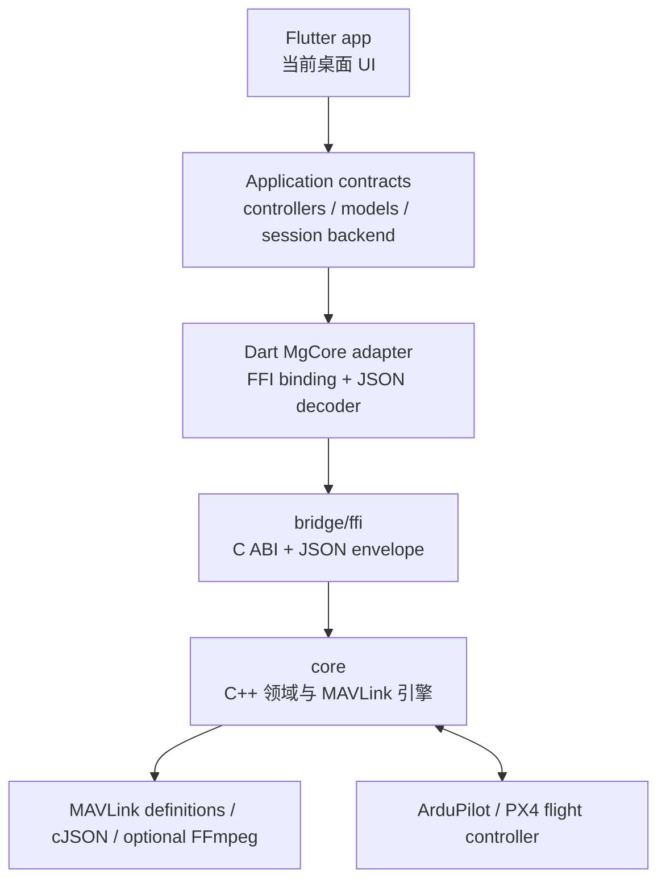

# M-GCS 全仓结构审阅报告

审阅日期：2026-07-29

## 结论摘要

M-GCS 已形成清晰的三层系统：C++ `mgcore` 负责飞控协议与领域能力，`bridge/ffi` 提供稳定的 C ABI/JSON 契约，Flutter 作为当前桌面前端适配器。这个方向正确，也支持未来增加 Swift、React、Web 或 CLI，而无需重写连接、MAVLink、参数、任务和校准能力。

项目当前最重要的工程工作不是继续堆叠 UI，而是先固化构建可复现性、补齐前端接入与后端能力之间的断层，并以离线测试把新增 Mission CAD 等复杂领域能力稳定在 core/FFI 边界内。

| 维度 | 当前判断 | 说明 |
| --- | --- | --- |
| 后端领域能力 | 基础扎实、范围较广 | 已有传输、MAVLink、参数、任务、校准、围栏、日志、地形、SITL 和多机结构。 |
| FFI 边界 | 方向正确 | 领域 API 分组、JSON envelope 与字符串所有权规则明确，且有 API 目录。 |
| Flutter 前端 | 可用但接入面仍较窄 | 已接入真实串口、遥测、参数与部分配置；任务等能力尚未形成完整工作流。 |
| 平台交付 | macOS 优先，Windows 待验收 | Android/iOS 平台工程和包装尚未恢复。 |
| 构建可复现性 | 当前主要风险 | MAVLink C 生成头不入库，CI 还没有自动生成步骤。 |
| 飞控安全 | 规则明确，验收未完成 | 危险写操作有隔离要求，但尚未完成真实硬件验收。 |

## 审阅范围与规模

本次为全仓静态结构审阅：覆盖顶层构建与 CI、`core/`、`bridge/ffi/`、`app/`、测试、工具、第三方依赖和当前维护文档；同时检查了主入口、公共 API、连接/飞控/参数/校准关键头文件和 Flutter 页面入口。

当前工作区的可统计源码规模如下，第三方 MAVLink 上游源码和构建缓存不计入主要行数：

| 项目 | 数量 |
| --- | ---: |
| Git 已跟踪文件 | 422 |
| C/C++ 源文件与头文件（`core`、`bridge`、`tests`） | 216 |
| 后端与 FFI 代码行（不含测试） | 约 33,949 |
| Dart 源与测试文件 | 65 |
| Dart 代码行（含测试） | 约 17,536 |
| 测试源码文件 | 54 |
| FFI 源文件与头文件 | 67 |

审阅时工作区并非干净状态：已有大量后端、FFI、Flutter、文档和测试变更，以及若干未跟踪的新页面、工具和 Mission CAD 文档。本报告描述的是当前工作区的结构，不把这些未提交改动视为已发布版本。

## 总体架构

依赖方向总体合理：Flutter feature 不直接调用底层 FFI，协议和安全敏感状态机留在后端。`bridge/ffi` 虽然与 core 编译为同一个 `mgcore` 动态库 target，但它仍是外部消费者唯一公共 API 面；后续应继续维持这个逻辑边界，不把 C++ 领域类型泄漏到 Dart 或其他前端。

## 模块结构

### 1. C++ 后端：`core/`

`core/` 是项目的主能力层，采用 C++17、CMake 和跨平台适配结构。

| 子域 | 主要职责 | 现状 |
| --- | --- | --- |
| `transport/` | 串口、TCP、UDP、内存链路、端口发现、连接生命周期 | 已具备多链路抽象；串口是当前 Flutter 已接入的路径。 |
| `mavlink/` | adapter、发送器、命令队列、参数缓存、任务传输 | 安全敏感核心，已覆盖基本协议状态机。 |
| `vehicle/` | 飞控对象、多机管理、活动飞控选择 | 为多飞行器扩展保留了正确模型。 |
| `firmware/` | ArduPilot/PX4 profile、模式、参数重映射、刷写骨架 | ArduPilot 优先；刷写尚未达到生产验收。 |
| `mission/` | `MissionPlan`、任务编辑、导入导出、测绘/走廊扫描 | 已有 MAVLink 任务模型；Mission CAD 将在此之上建立源模型与编译器。 |
| `calibration/` | 校准状态机、策略、验证器和历史 | 已将加速度计、罗盘、陀螺仪和气压计差异封装为策略。 |
| `config/` | 参数元数据、枚举选项、双语翻译、`.param` 文件 | 是参数编辑器使用下拉选项和中英说明的后端基础。 |
| `telemetry/`、`log/`、`settings/` | 环形缓存、ADSB、飞行和 MAVLink 日志 | 后端能力已具备，前端接入仍不完整。 |
| `geofence/`、`terrain/`、`camera/`、`video/`、`sitl/` | 围栏、地形、相机、视频、仿真 | 均有模块入口；视频、地形和部分仿真还需产品级验收。 |

后端的公共 C++ 头集中在 `core/include/core/`，实现集中在 `core/src/`。这是健康的库结构。当前 `CMakeLists.txt` 显式列出所有编译源文件，因此新增 C++ 模块时必须同时更新 CMake；这比自动 glob 更可控，但漏登记会直接导致功能未进入库，应在新增模块检查单中保留这一项。

### 2. C ABI 桥接：`bridge/ffi/`

`ffi_api.h` 是总入口，按核心、连接、遥测、固件、参数、任务、飞行、配置、围栏、日志、载荷和环境分拆头文件。返回复杂对象时统一使用 JSON，任何返回的 `char*` 均由调用方通过 `mg_free_string()` 释放。

这个边界是项目可更换前端的关键资产。`API_CATALOG.md` 已区分 preferred、compatibility 和 specialized API，避免 Flutter 当前未使用的能力被误删。建议后续保持以下原则：

- 新能力先定义后端语义和版本化 JSON，再增加 Dart、Swift 或 Web 绑定。
- 兼容 API 只维护，不继续扩展给新调用方。
- 聚合诊断和长操作快照优先于让每个界面拼接多个底层响应。
- FFI 代码不出现 UI 控件、页面、widget 或地图供应商概念。

### 3. Flutter 应用：`app/`

Flutter 应用分为应用契约、业务 feature、地图封装、shell 和自有皮肤系统：

| 目录 | 职责 |
| --- | --- |
| `lib/application/` | `ConnectionController`、会话接口、参数控制器、领域模型。 |
| `lib/application/mgcore/` | native library 加载、FFI 调用、JSON 解码及 MgCore 会话适配。 |
| `lib/features/frontstage/` | 地图前台、连接抽屉、仪表盘与任务入口。 |
| `lib/features/backstage/` | 参数、舵机输出、串口、遥控与传感器/外设配置页面。 |
| `lib/features/map/` | 地图源、地图 surface、设备定位封装。 |
| `lib/ui/skin/`、`lib/ui/skins/mac_glass/` | 皮肤协议、token 与当前默认视觉实现。 |
| `macos/`、`windows/` | Flutter 平台壳与 native library 打包。 |

`ConnectionSessionBackend` 是 Flutter 依赖的核心抽象。当前 `MgCoreConnectionSessionBackend` 同时实现连接、参数、参数文件、实时输出、遥控输入、串口硬件映射、校准和传感器遥测等多个小接口。这种按能力拆分的接口形态适合测试和替换实现；随着业务继续增长，应继续增加细粒度领域接口，不要把页面直接绑定到 `MgCoreConnectionClient`。

前台和后台由 `IndexedStack` 切换，页面状态可以保留。当前前端已有真实连接、参数同步、参数读写、`.param` 文件读写、舵机/遥控/串口和校准接入；不过 API catalog 显示 mission、flight command、geofence、payload、logging、SITL 和 firmware 仍主要是后端/FFI 专用能力，尚未构成 Flutter 完整工作流。

### 4. Mission CAD：已完成架构起点，尚未实现代码

[Mission CAD 初步设计](MISSION_CAD.md) 和 ADR 0005 已将任务规划设计为前端无关的后端子系统：

- `MissionCadDocument` 是带实体、约束和 ENU 坐标的可编辑源模型。
- `MissionPlan` 是编译后的 MAVLink 目标模型，不是 CAD 文档的源数据。
- core 负责几何、坐标换算、编译、估算、校验、诊断和源到任务项映射。
- 前端只处理地图/画布交互和结果渲染。

这是满足未来多用户、多 UI 形态的正确边界。首个实现里程碑应只做 core 数据模型、JSON 往返、ENU/WGS84 换算和离线测试，不应先做 Flutter 画布。

## 构建、依赖与交付

### 本地构建

- 后端使用 CMake 3.16+、C++17，输出共享或静态 `mgcore`。
- 测试构建同时生成 `mgcore_static`，使测试能覆盖 FFI 实现。
- macOS 链接 IOKit 与 CoreFoundation；Windows 链接 SetupAPI 与 Winsock；Linux 使用 pthread。
- FFmpeg 是可选能力，缺少时视频解码被关闭。
- Flutter 依赖为 `ffi`、`file_selector`、`window_manager`、`flutter_map`、`latlong2` 和 `geolocator`，依赖数量克制。
- `tools/build-desktop-macos.sh` 与 `tools/build-desktop-windows.ps1` 用于将 native library 和桌面 app 一并构建。

### 第三方依赖

- MAVLink：仓库保存 XML 定义和上游源码，但不保存生成后的 C 头。
- cJSON：以 vendored 源码编译进 `mgcore`。
- FFmpeg：可选的系统依赖，不是默认构建前提。

最关键的问题是 MAVLink C 头需本地使用固定版本 `pymavlink 2.4.49` 生成，而 GitHub Actions 的当前流程只有 CMake、构建和 CTest，没有生成步骤。因此新 checkout 的 CI 或开发环境会在缺少 `third_party/mavlink/include/mavlink/v2.0` 时失败。该问题应优先修复。

### CI 与验证

当前 CI 在 Ubuntu 和 Windows 执行后端 `offline|simulation` 测试。测试代码按 offline、simulation、hardware、manual 进行分级，硬件和手动测试默认不注册到 CTest，这符合飞控安全要求。

项目文档记录的最近完整验证为 2026-07-21：后端 offline/simulation 29/29 通过，Flutter analyze 通过、Flutter test 52/52 通过，macOS Release 构建成功。审阅时存在后续未提交改动，因此这些历史结果不能替代当前工作区的重新验证。

## 风险与优先级

| 优先级 | 发现 | 影响 | 建议 |
| --- | --- | --- | --- |
| P0 | MAVLink C 生成头不入库，CI 不生成 | 新机器和 CI 不能保证可构建 | 在 CI 固定 Python/pymavlink 版本并执行 `mavgen`；本地构建脚本复用同一命令。 |
| P1 | 后端/FFI 能力显著多于 Flutter 工作流 | 用户看到的产品能力与后端资产脱节 | 按用户价值接入：Mission CAD、任务传输、告警/诊断、日志；每项先建立应用契约。 |
| P1 | macOS 之外的交付验证不足 | Windows 最终包和硬件行为仍有不确定性 | 在真实 Windows 机器完成构建、串口只读和 native library 装载验收。 |
| P1 | CI 未覆盖 Flutter、macOS 和移动端 | Dart/打包回归可能晚发现 | 添加 Flutter `analyze`、`test`、macOS build；移动平台恢复后再加入对应 job。 |
| P1 | 危险写操作未完成真机验收 | 不能把现有 API 直接视为可安全发布 | 为写参数、任务上传、校准、模式切换建立单独确认、超时、取消与硬件回归矩阵。 |
| P2 | 后台 UI 功能持续增长 | 页面状态与交互容易集中在单一文件 | 保持 feature controller/model 分层，将各后台域的状态和轮询从 page state 继续抽离。 |
| P2 | Mission CAD 仅有设计文档 | 不能尽早验证 CAD 模型是否足够 | 先实现不依赖 UI 的 core 文档模型与 fixture 测试，再增加 FFI 和任何画布。 |
| P2 | 可选视频、刷写、Android filesystem 等仍为骨架或未验收 | 对外能力说明可能过度乐观 | 在 UI 暴露前标注 capability 与验证状态，避免以 API 存在代替产品可用。 |

## 推荐推进顺序

1. 修复 MAVLink 生成和 CI，重新取得当前工作区的后端与 Flutter 基线测试结果。
2. 将当前工作区的参数、串口、遥控、舵机和传感器改动分批审阅、测试并提交，恢复可追溯基线。
3. 实现 Mission CAD 第 1 里程碑：`core/mission/cad` 数据模型、ENU/WGS84、`.mgcad.json` 往返与离线 fixture 测试。
4. 为 Mission CAD 定义 C ABI/JSON preview 契约，再由 Flutter 或其他前端实现编辑器。
5. 以 Windows 真实构建与只读连接为目标完成桌面交付闭环；随后再恢复 Android/iOS。
6. 对所有写飞控动作建立统一操作状态、超时、取消、明确确认和硬件验收矩阵。

## 架构判断

项目最有价值的长期资产不是当前的 Mac/iOS 风格 Flutter 页面，而是后端模型和 FFI 契约。只要持续遵守“领域逻辑在 core、语言边界在 FFI、交互在前端”的方向，替换 UI 技术栈只会重建呈现和调用适配，不会触及 MAVLink、连接、参数、任务或 Mission CAD 的核心实现。
