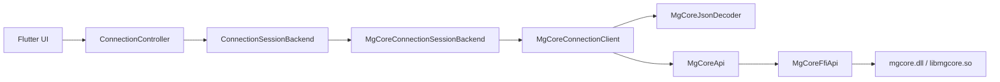

# ADR 0004：前端接入契约以连接会话为中心

## 状态

已采纳。

> 本 ADR 记录的是已经采纳的前端接入边界。当前 `app/` 已按该边界恢复 Flutter 桌面工程骨架，仍需继续补齐真实业务页面和 native MgCore library 打包。

## 背景

Flutter 前端早期直接围绕 MgCore FFI 快照接入：

- 控制器需要知道 `ConnectionBackendClient`。
- 控制器直接消费 `AttitudeSnapshot`、`VfrHudSnapshot` 等后端快照。
- 测试需要伪造底层 MgCore client，而不是伪造前端真实关心的连接会话。
- 后续接入更多页面时，容易把 FFI envelope、遥测字段组合、连接状态判断扩散到 UI 层。

这会让前端接入变重，也会让后端 API 语义层很难稳定演进。

## 决策

前端应用层以 `ConnectionSessionBackend` 作为接入契约。

这个契约表达前端真实需要的语义：

- `listSerialPorts()` 提供可选串口。
- `connect(request)` 执行连接并返回操作结果。
- `disconnect()` 执行断开。
- `loadSessionSnapshot(request)` 读取连接摘要和首帧仪表盘数据。
- `loadTelemetrySnapshot()` 读取后续仪表盘遥测快照。

`ConnectionController` 只依赖这个会话契约，不直接依赖 MgCore FFI client，也不直接消费 MgCore 的底层快照类型。

MgCore 相关细节被限制在 `MgCoreConnectionSessionBackend` 后面：

- `MgCoreConnectionClient` 负责把 MgCore JSON 响应解析为底层 Dart 快照。
- `MgCoreConnectionSessionBackend` 负责把底层快照组合成前端会话语义。
- UI 和控制器只看到 `ConnectionSessionSnapshot`、`AppConnectionSummary`、`FlightDashboardData`。

历史前端中的旧 `MgCoreVehicleSessionAdapter` 命名已被淘汰。后续恢复前端代码时，新代码应直接使用 `MgCoreConnectionSessionBackend`。

## 目标结构

## 影响

1. 新前端页面优先接入 `ConnectionController` 或 `ConnectionSessionBackend`，不直接接入 MgCore FFI。
2. MgCore 字段变更时，优先修改 `MgCoreConnectionClient` 和 `MgCoreConnectionSessionBackend`。
3. 前端测试应优先伪造 `ConnectionSessionBackend`，只在 MgCore 会话后端测试中伪造 `ConnectionBackendClient`。
4. 如果后续 TCP/UDP、回放、SITL、真机硬件入口并存，它们应作为新的 `ConnectionSessionBackend` 实现，而不是让 UI 分支判断后端类型。
5. `ConnectionController` 的架构守卫测试会阻止它重新依赖 `mgcore_connection_client.dart` 或底层遥测快照类型。
